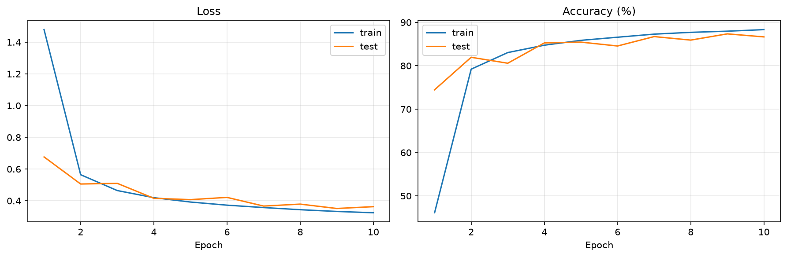
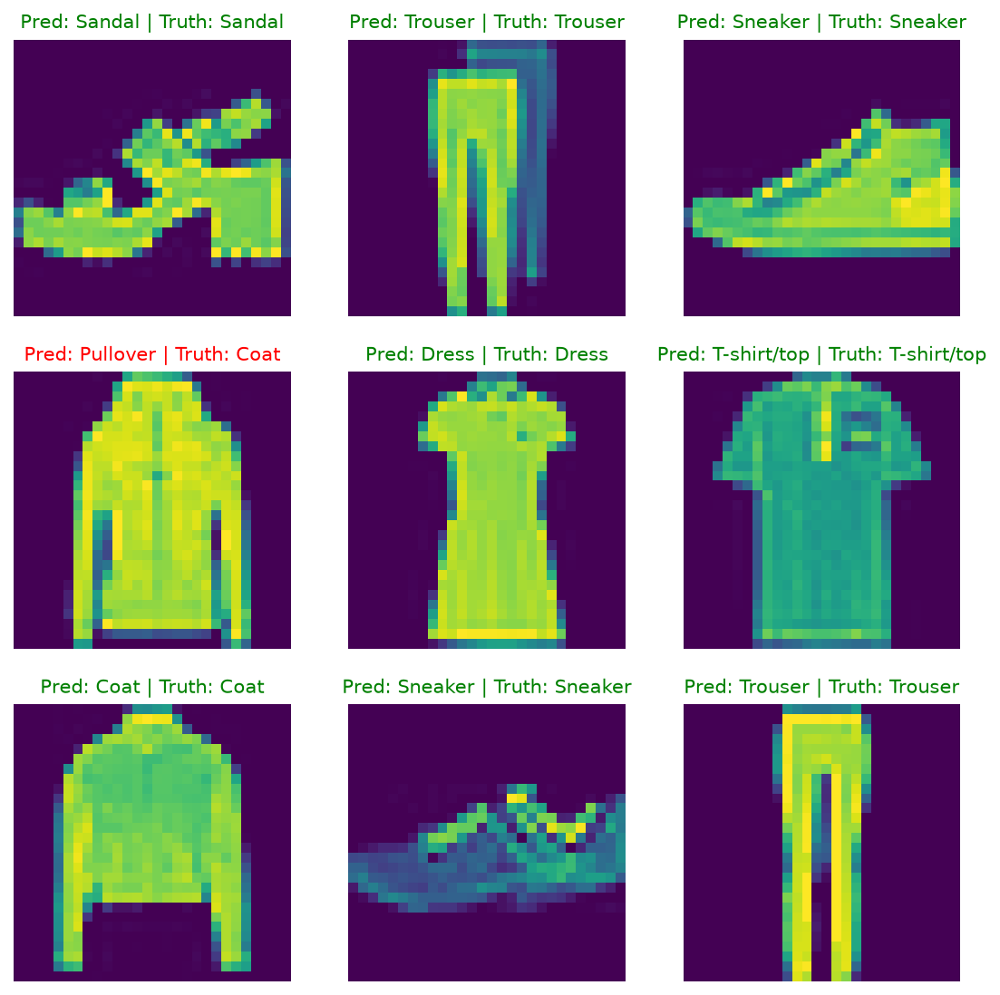

# FashionMNIST CNN in PyTorch

A small CNN (TinyVGG-style) trained on FashionMNIST. The architecture and `helper_functions.py` follow the computer vision chapter of [learnpytorch.io](https://www.learnpytorch.io). The training script, curves and analysis are mine.

## Setup

2 conv blocks (2x Conv3x3 + ReLU + MaxPool each) + linear classifier, 10 hidden channels. SGD, lr=0.01, batch size 32, 10 epochs, CrossEntropyLoss.

## Results (epoch 10)

| | loss | accuracy |
|---|---|---|
| train | 0.3248 | 88.33% |
| test | 0.3631 | 86.65% |

Train accuracy is a running average over the epoch (weights still improving), test is measured at the end of the epoch. The best test accuracy was 87.35% (epoch 9), but the checkpoint was selected on the test set, so that number is optimistic. The epoch-10 numbers are the honest ones.

## Observations

- Small train/test gap (loss 0.325 vs 0.363, under 2 accuracy points): no sign of overfitting.
- Train loss is still falling at epoch 10 and train accuracy sits around 88%. With only 10 hidden channels the model looks capacity-limited, not overfit.
- Test accuracy is noisy between epochs (80.58% at epoch 3, 85.26% at epoch 4), so single-epoch numbers should not be over-read.
- An earlier run with lr=0.1 for 3 epochs reached a similar best test accuracy (87.21%), so the learning rate is not the bottleneck.
- The 9-image sample (fixed seed) is 8/9 correct. The one miss is a Coat predicted as Pullover, a typical confusion among upper-body garments. 9 images is too few to measure accuracy, and I have not computed a full confusion matrix yet.

## Limitations and next steps

- The best checkpoint is selected on the test set. Next: hold out a 5k validation split, select on it, and evaluate test once.
- Try 64 hidden channels to confirm the capacity limit.
- Add a confusion matrix.

## My deep learning path

1. Andrew Ng's Machine Learning Specialization: linear and logistic regression, gradient descent, L2 regularization.
2. From scratch in NumPy: sigmoid, cost, gradient, gradient descent, predict.
3. PyTorch fundamentals and classification: [pytorch-classification-basics](https://github.com/Salman-Elhaddadi/pytorch-classification-basics).
4. Computer vision / CNNs: this repo.

## Run

    pip install -r requirements.txt
    python train.py

FashionMNIST is downloaded automatically into `data/` (git-ignored). Plots are saved to `images/`.

## Credits

Architecture and helper functions: [learnpytorch.io](https://www.learnpytorch.io) by Daniel Bourke.
